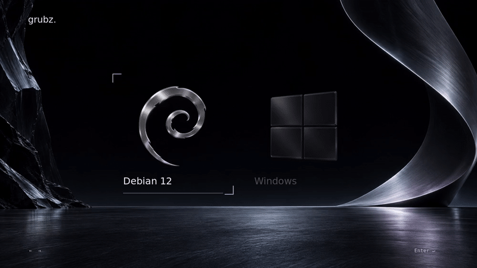

# Grubz rEFInd

A graphical rEFInd derivative with native inactive-icon dimming and a sliding
selection highlight. Based on **rEFInd 0.14.2**, preserving upstream Git history
and licenses. Experimental: tested in an isolated QEMU/OVMF VM, not installed
on a physical machine.



## Native selection

```ini
inactive_icon_brightness 32
selection_animation_ms 120
```

The selection artwork slides between adjacent OS entries with smoothstep easing;
icon brightness follows the motion. Original icon alpha is preserved. No special
transparency encoding, baked background patches, or fixed pixel coordinates are
required by the renderer. The Obsidian theme is provided separately in `grubz/theme`.

- Brightness: 0–100 percent; default 32. Out-of-range values revert to 100.
- Duration: 0–1000 ms; default 120. Zero disables motion. Out-of-range values revert
  to 120. Firmware rendering cost may exceed the nominal duration by a frame.
- UEFI timer milestones skip overdue frames instead of accumulating delay.
- Pending keyboard/pointer input interrupts motion and snaps to the target;
  the normal menu loop handles the pending input. Rapid changes prioritize input
  over completing the animation.
- Initial paint, scrolling, nonadjacent shortcuts, tool-row and pointer selection
  remain static. The text-mode menu is unchanged.
- Allocation/timer failures fall back to static rendering.

## Build and tests (Debian/Ubuntu x86-64)

Dependencies: `build-essential gnu-efi`. Then:

```sh
bash grubz/test.sh
bash grubz/build.sh
```

Output: `refind/refind_x64.efi`. `GNU_EFI_ROOT=/path/to/extracted/package` can point
to an extracted GNU-EFI `.deb`, avoiding a system-wide development-library install.
The build does **not** install a boot manager. This binary is unsigned.

## Isolated VM preview

Additional dependencies: `qemu-system-x86 qemu-system-gui ovmf grub-efi-amd64-bin
mtools dosfstools gdisk imagemagick`.

```sh
bash grubz/build-vm.sh
bash grubz/run-vm.sh
```

The VM has only a regular-file virtual disk, its own OVMF variables, and no network,
host disks, shared folders, or passthrough devices. No host ESP, GRUB configuration,
or firmware boot order is modified. `timeout 0` keeps rEFInd waiting for input.
Both menu entries launch clearly labeled **demo EFI loaders**, not Windows/Linux
installations. Use `Return to rEFInd` to return. Close QEMU to stop the VM.
Rebuild only after stopping it; rebuilding replaces the disposable VM files.

This verifies the real menu renderer and EFI handoff to demo loaders. It does not
validate physical firmware, Secure Boot, BitLocker, or installed operating systems.

### Separate Secure Boot VM

Secure Boot enforcement is tested separately with disposable keys and a signed
EFI probe. See [the procedure and observed results](grubz/SECUREBOOT.md).
This uses direct firmware `db` trust, not the Debian shim/MOK chain.

## Upstream maintenance

Upstream: https://git.code.sf.net/p/refind/code

Base tag: `v.0.14.2`, commit `6c66e90b3d36c1b4c7b0067203be2ba99a0380fb`.
The `grubz` branch contains our changes. Keep upstream history and merge future
releases on a separate update branch, then run tests and the VM before merging:

```sh
git remote add upstream https://git.code.sf.net/p/refind/code # once per clone
git fetch upstream --tags
git switch -c update/upstream-next
# git merge <reviewed-upstream-tag>
```

GitHub Actions builds and tests pushes/PRs. Updates are deliberate; no automation
installs or deploys this to firmware.

## Artwork and licensing

Obsidian background and metallic OS emblems were generated specifically for this
project with OpenAI image generation; theme PNGs include layout/text composition.
The Debian and Windows names/marks identify the boot choices; no affiliation or
endorsement is implied. Original upstream copyright and licensing notices are
preserved in `LICENSE.txt` and source files. New Grubz code is GPL-3.0-or-later.
