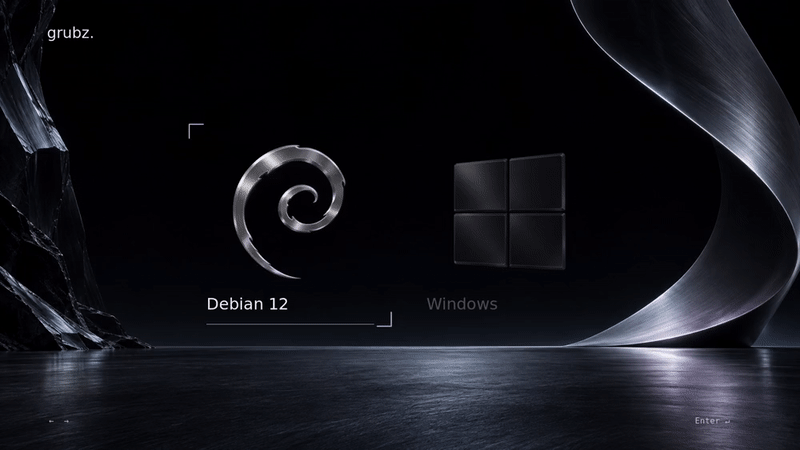

# Grubz rEFInd

Um seletor de boot com tema escuro, ícones personalizados, escurecimento nativo dos
itens inativos e seleção que desliza entre os sistemas. O Grubz funciona antes do
sistema operacional e é um derivado do **rEFInd 0.14.2**, não do GNU GRUB.

[English](README.md) · [Guia de uso e recuperação (EN)](docs/USER-GUIDE.md) ·
[Configuração da interface (EN)](docs/CONFIGURATION.md)



## O que funciona hoje

O mantenedor confirmou o Grubz como seletor permanente no seu PC com dual boot
Debian 12/Windows, incluindo boot direto do Debian com Secure Boot ativo.
A atualização automática de kernel foi validada numa instalação real de Debian
em VM. A entrada original do Windows foi preservada; este relato não afirma um
teste de boot físico do Windows. É um projeto pessoal experimental, não um
instalador universal nem uma garantia para qualquer firmware.

- Interface nativa em C: seleção deslizante e brilho dos ícones acompanhando a troca.
- Fundo e emblemas gerados especificamente para o projeto, com composição do tema.
- Sem boot automático: `timeout 0` no rEFInd aguarda uma escolha.
- Boot direto opcional do Debian usando uma imagem EFI assinada que reúne kernel,
  initramfs e parâmetros de inicialização (UKI).
- Hooks para recriação de initramfs e remoção de kernel; publicação da nova imagem
  após validação da assinatura, preservando a imagem anterior.
- Testes de Secure Boot com firmware virtual e cadeia shim/MOK, inclusive rejeição
  de imagens sem confiança ou adulteradas.

## Comece pela VM

Alvo validado: x86-64 UEFI, usando ferramentas Debian/Ubuntu. Os comandos abaixo
instalam dependências de desenvolvimento e criam arquivos de VM, não alteram seu
carregador de boot, sua partição EFI ou a ordem do firmware.

```sh
git clone --branch grubz https://github.com/Muriel-Gasparini/grubz-refind.git
cd grubz-refind
sudo apt-get install build-essential gnu-efi python3 qemu-system-x86 \
  qemu-system-gui ovmf grub-efi-amd64-bin mtools dosfstools gdisk imagemagick
bash grubz/test.sh
bash grubz/build.sh
bash grubz/build-vm.sh
bash grubz/run-vm.sh
```

A VM de preview inicia **loaders de demonstração**, não instalações de Debian e
Windows. Ela não conecta discos físicos. Feche o QEMU antes de reconstruí-la.
O binário compilado é `refind/refind_x64.efi` e sai **sem assinatura**.

## Configuração

```ini
timeout 0
inactive_icon_brightness 32
selection_animation_ms 120
resolution 1920 1080
```

Escolha uma resolução que o firmware ofereça. Os 120 ms são um alvo; o custo de
renderização depende do equipamento. A animação ocorre com as setas entre itens
adjacentes visíveis; seleção pelo mouse, rolagem e atalhos distantes são estáticos.
O `timeout 0` tem significado diferente no GRUB: lá ele inicia imediatamente.

## Instalação, assinatura e recuperação

Leia o [guia de instalação em etapas](docs/USER-GUIDE.md) antes de usar no PC real.
Não copie UUIDs, números de entradas EFI ou chaves de outra máquina. Preserve os
loaders originais e teste uma inicialização antes de mudar o padrão permanente.

- [Testes isolados de Secure Boot](grubz/SECUREBOOT.md)
- [Validação Debian shim/MOK](grubz/SHIM-MOK.md)
- [Boot direto, configuração de UKI e hooks](grubz/DIRECT-BOOT.md)

A imagem anterior depende dos módulos daquele kernel ainda instalados. Ela não
substitui uma estratégia de recuperação. Falhas na geração/assinatura devem ser
resolvidas antes de contar com a atualização do boot direto.

## Créditos e licença

O projeto preserva o histórico e os créditos do rEFInd. Código novo do Grubz:
GPL-3.0-or-later; veja `LICENSE.txt` e os avisos nos fontes. O desenvolvimento foi
feito com apoio do OpenAI Codex; o artwork foi criado com geração de imagens da
OpenAI. Debian e Windows identificam as opções de boot; não há afiliação ou endosso.

Contribuições são bem-vindas: descreva equipamento, firmware, versão do Grubz e
passos para reproduzir. Não publique chaves privadas ou dumps pessoais de firmware.
