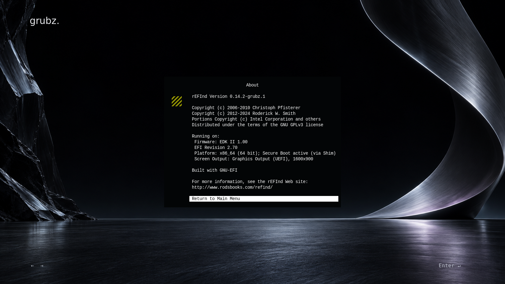

# Debian shim/MOK validation in an isolated VM

This document records the isolated VM stage. The project subsequently completed
physical Debian boot testing; see the [current status](../README.md) and
[direct-boot results](DIRECT-BOOT.md). The scope of the tests below is unchanged.

Validated on 2026-11-13. No host boot files, firmware entries, or MOKs were changed.
All firmware writes went to regular OVMF variable files under ignored `shim-local/`.

## Chain and trust boundary

OVMF (Secure Boot, Microsoft trust) → Debian signed shim → Grubz signed with
the VM test certificate trusted **only through MOK** → signed EFI demo loaders.

The custom certificate was absent from the virtual firmware's PK, KEK, db and dbx.
Shim validation was not disabled via MokSBState. The rEFInd About screen reported
`Secure Boot active (via Shim)`.



Versions tested:

- `shim-signed`: `1.51~1+deb12u1+16.1-2~deb12u1`
- `shim-unsigned`: `16.1-2~deb12u1` (provides the corresponding build)
- `ovmf`: `2022.11-6+deb12u2`
- `qemu-system-x86`: `1:7.2+dfsg-7+deb12u18+b3`
- Grubz: `0.14.2-grubz.1`, using the signed artifact from the direct-db test.

The Microsoft-signed Debian shim at `/usr/lib/shim/shimx64.efi.signed` had SHA-256
`0fc347af103ec1dfac6e3f184c0a5241a2ce756a0932b359c404d39c45423806`.
Shim and MokManager were copied unchanged; neither was re-signed with our key.

## Observed results

| Case | Result |
|---|---|
| Trusted signed Grubz + MOK | Selector starts; Secure Boot active via Shim |
| Same signed Grubz, no MOK | `Verification failed: (0x1A) Security Violation` |
| Unsigned Grubz + MOK | Same security rejection |
| Grubz signed by another key + MOK | Same security rejection |
| Grubz altered after signing + MOK | Same security rejection |
| Debian signed demo through Grubz | Demo loader menu reached |
| Windows signed demo through Grubz | Demo loader menu reached |

Each negative case booted a separate virtual disk/variable store. Rejections
were recorded in QEMU serial logs and framebuffer screenshots.

## Interactive enrollment test

An additional VM started without MokList and initially rejected the signed Grubz.
In Debian MokManager we chose **Enroll key from disk**, selected
`Grubz-VM-TEST.cer`, checked the certificate fingerprint, and confirmed enrollment.
After rebooting the same VM without rebuilding its variable store, Grubz started
and reported Secure Boot active via Shim. Offline inspection confirmed that
MokList now contains the certificate while PK, KEK, db and dbx remain byte-identical.

This tests actual MokManager enrollment, not just pre-populated MOK variables.
It does not test `mokutil --import` from an installed Linux guest.

## Reproduce

First build the [direct-db test artifacts](SECUREBOOT.md); these supply the local
test keys, signed/unsigned images, extracted tools and demo loaders. Do not use
these disposable keys for production. Additional files come from Debian's
`shim-signed` package. No package installation is performed by the scripts.

```sh
bash grubz/shim-build.sh trusted
bash grubz/shim-run.sh trusted
```

Use `unsigned`, `untrusted`, `tampered` or `no-mok` instead of `trusted` for
negative cases. `enroll` creates a VM without MOK and puts the public DER
certificate on its virtual disk for interactive enrollment. After selecting
Reboot in MokManager, QEMU exits because the launcher uses `-no-reboot`;
run `bash grubz/shim-run.sh enroll` again **without rebuilding**.

The About tool is enabled only in these diagnostic configurations. Select the
small lower-row tool to inspect the status. Close QEMU before rebuilding a case.
Rebuilding resets that case's disposable disk and variable store, including any
interactive enrollment. `GRUBZ_VM_DISPLAY=none` enables headless testing via QMP.

## Remaining limits

These are EFI demonstration loaders, not installed Debian/Windows systems.
The VM's Microsoft trust, dbx and shim SBAT state are not a copy of the physical
machine's revocation state. Passing this test does not guarantee acceptance by
every firmware or future shim/SBAT update. No host installation was performed.

References: [shim trust model](https://github.com/rhboot/shim),
[rEFInd Secure Boot](https://www.rodsbooks.com/refind/secureboot.html).
